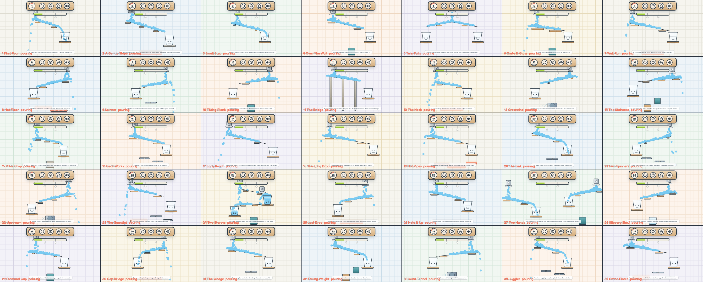
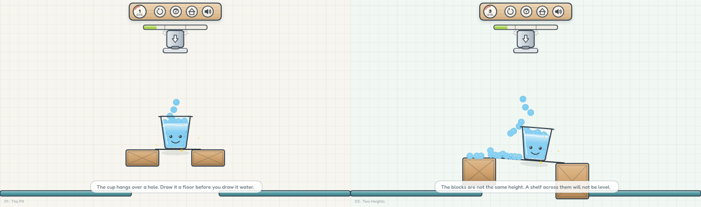
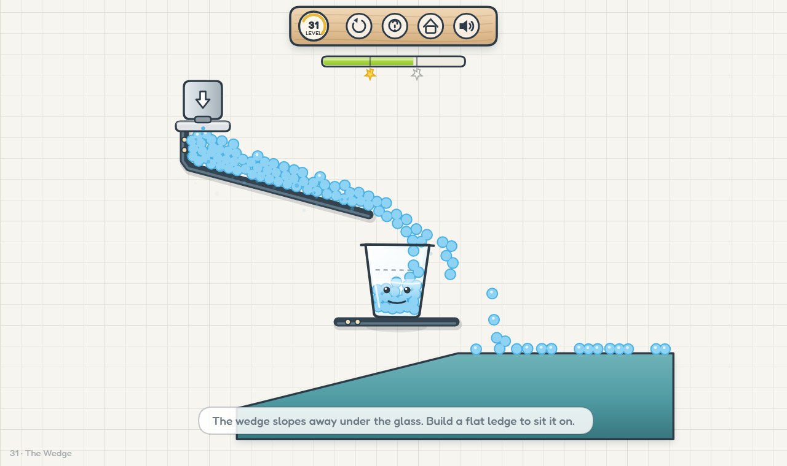
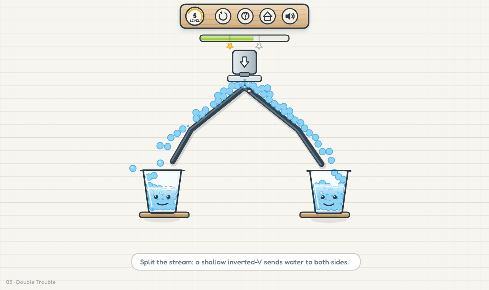

# Happy Glass — Draw. Pour. Smile.

A browser clone of **[Happy Glass](https://poki.com/en/g/happy-glass)** (Lion Studios): you draw a
line, the tap opens, and water has to end up **inside the sad glass** so it smiles again. Draw less
ink → more stars.

Glasses are **physical objects**. Many levels hang the glass in mid-air with nothing under it — the
moment the world starts moving it drops — so half of the puzzle is *building a shelf or ledge for it*
before you even think about the water. Your ink obeys gravity too: a stroke that is not hooked onto
scenery (ledges, crates, the tap housing, or the push-pins dotted around later levels) falls out of
the level the instant you release it.

Vanilla JS + [Matter.js](https://brm.io/matter-js/) physics. No frameworks, no build step required,
no runtime dependencies. 35 hand-tuned levels, three-star ink scoring, sound synthesised with the
WebAudio API (no audio files), and a fully offline single-file build.

```
npm start            # http://localhost:4173
npm run build        # dist/happy-glass.html  (one self-contained file, open it anywhere)
npm run verify       # headless playthrough of all 35 levels
npm run audit        # physics audit: masses, colliders, tunnelling, resting contact
npm run flaky        # plays every level 4x and fails if any run loses
npm run smoke        # boots the built file in jsdom and plays a level end to end
npm run shots        # renders canvas screenshots to shots/
```



| A floating glass must be propped up | …then it fills like any other |
| --- | --- |
|  |  |

| Ink hung from the tap splits one stream in two | Falling ink is real ink: unsupported lines drop out |
| --- | --- |
|  |  |

---

## 1. How the real game works (research summary)

Sources consulted while designing this: Lionsharp/Lion Studios' original, the Poki web port, and
long-form guides (supercheats, spacewaves, yuppiy, onelinedraw, plays.org).

| Topic | Original behaviour | What this clone does |
| --- | --- | --- |
| **Core loop** | A tap/faucet pours water; you draw one or more solid ink lines that act as ramps, funnels and walls; the glass must fill above its dotted line. | Identical. The tap stays shut and the world is frozen while you plan; **lifting the pencil after your first line opens the tap**, and any line you draw later is added to the same running world. |
| **Win condition** | Fill the glass to the dotted line; the glass smiles. | Fill ratio is measured from the real water surface **and** droplet count inside the glass. Every glass in a level must be filled. |
| **Stars** | Stars come from **ink economy, not water saved**: the green meter is split into three blocks, every block you eat costs a star (3 / 2 / 1). | Identical 3-block meter, measured in pixels of line length against a per-level budget. |
| **Draw rules** | You draw on the level, but not *through* scenery, glass or into no-draw zones; the stroke becomes a physical object that water flows over, and it can only hang where it is anchored to something. | Blocked inside planks, crates, the tap and inside the glass (you *may* draw right under the nozzle and just above the rim). On release every segment is tested against the scenery with a real collision query: each place it actually touches becomes an **anchor** and the wire is welded there — the drawing itself is never decorated, it stays the plain line you drew. A line that touches one thing only swings from that point; no contact at all → the whole line stays one rigid body and falls. If an anchoring support later moves away, the line comes off and drops. |
| **Hazards** | Hot pads evaporate water, gears/spinners scatter it, some levels need multiple glasses filled at once, fans push water. | All of the above are implemented: heated pads, pinned bars (free pin joints that only turn when something hits them), tilting planks, blowers (the grey arrow box), crates and diamonds, brackets/shelves/pegs/columns, 1–2 glasses and 1–2 taps. **Nothing in a level moves on its own.** |
| **The glass itself** | The cup is not scenery: it falls, tips and can be caught with your ink. Later levels drop it, wedge it between blocks or leave it hanging over a gap. | Same. Every glass is a single **compound rigid body** with a weighted base (a splash will not knock it over, but an unsupported glass really does fall). A glass that is meant to stand starts on a small wooden ledge; a glass that is meant to hang has nothing under it and *will* drop unless your ink catches it. Knock it over and the level fails with "the glass fell over". |
| **Retry** | Retry is free and instant; you keep trying until the water runs out. | Restart button (or `R`), plus automatic fail detection once the tap is empty and the water has settled. |
| **Feel** | Hand-drawn look, thick dark outlines, pastel palette, paper grid, wooden HUD, bouncy UI, happy glass face. | Same art direction, drawn procedurally on a canvas (no image assets at all). |

Design takeaways that shaped the level list:

* **Aim at the middle of the stream**, not every drop — lines that try to catch everything are expensive.
* **Short hooks/wedges anchored on scenery beat long bridges** — both cheaper and more stable.
* Water has momentum: it slides, piles up and pushes; a shallow ramp can stall water, a steep one overshoots.
* Every element in a level should be *needed* — so no decorative-only obstacles here.
* **Ink is heavy**: a line that is not pegged to scenery drops out of the world, so a good level gives
  you a pin, a ledge or a wall near where the line has to start.

---

## 2. What's in the box

```
index.html          the game shell + DOM UI (menu, level select, how to play, result dialogs)
css/style.css       all UI styling (fonts, buttons, sheets, dialogs, rotate hint)
js/util.js          helpers, palette, save data (localStorage), star maths
js/audio.js         WebAudio sfx: pour bed, plops, draw scribble, star chime, win/fail jingles
js/levels.js        35 hand-authored levels (data only, easy to extend)
js/scene.js         level → Matter.js world: scenery, glasses, taps, ink strokes, win/lose logic
js/water.js         the fluid: up to 300 soft droplets, fans, hazards, cosmetic splashes
js/render.js        the whole look: paper grid, platforms, glasses + faces, water, HUD, overlays
js/ui.js            DOM screens, level grid, dialogs, sound toggle
js/game.js          fixed-step loop, pointer input, level flow, scoring, keyboard shortcuts
vendor/matter.min.js Matter.js 0.20.0 (MIT)
fonts/              Fredoka woff2 subsets (OFL)
tools/              dev server, single-file builder, headless simulator, verifier, screenshots
```

### Levels

35 levels. Every one of them is **generated and then proved**: `tools/design.js` places the
tap and the glass, solves the ballistic aim that lands the water in the mouth, searches for the
scenery that will carry a drawn line to that aim, and then plays the finished level four times —
once with its own line and three more with the same line nudged by a pixel or two. A level only
ships if a hand-drawn line, not a machine-perfect one, wins it. The reference solutions in
`tools/solutions.js` are the lines that proof used.

The variety is in the *shape of the thing you rest the line on* — a floating bracket, a small peg,
a wide shelf, or a stone column standing on the ground — and in where the tap, the glass and the
hazards sit. Nothing moves on its own: the pinned bars are scenery that only turns once water or a
line hits it.

| # | Name | Structure |
| --- | --- | --- |
| 1 | First Pour | 2 brackets · one glass |
| 2 | A Gentle Slope | 3 brackets · one glass · 1 hot pad |
| 3 | Small Step | 2 pegs · one glass |
| 4 | Over The Wall | 2 brackets · one glass · teal crate |
| 5 | Twin Falls | 2 brackets · one fork, two glasses |
| 6 | Crate & Glass | 2 shelves · one glass · teal crate |
| 7 | Wall Run | 2 brackets · one glass · 1 hot pad |
| 8 | Hot Floor | 2 brackets · one glass · 2 hot pads |
| 9 | Spinner | 2 pegs · one glass · 1 pinned bar |
| 10 | Tilting Plank | 2 brackets · one glass · teal crate |
| 11 | The Bridge | 3 columns · one glass |
| 12 | The Neck | 2 brackets · one glass · 1 hot pad |
| 13 | Crosswind | 2 pegs · one glass · blower |
| 14 | The Staircase | 3 brackets · one glass · wood+teal crate |
| 15 | Pillar Drop | 3 brackets · one glass · stone crate |
| 16 | Gear Works | 2 brackets · one glass · 2 pinned bars |
| 17 | Long Reach | 2 brackets · one glass |
| 18 | The Long Drop | 2 brackets · one glass |
| 19 | Hot Pipes | 2 brackets · one glass · 3 hot pads |
| 20 | The Sink | 2 brackets · one glass · 1 pinned bar |
| 21 | Twin Spinners | 2 pegs · one glass · 2 pinned bars |
| 22 | Upstream | 3 brackets · one glass · blower |
| 23 | The Gauntlet | 2 brackets · one glass · 1 hot pad, 2 pinned bars |
| 24 | Two Storeys | 4 brackets · two glasses, high and low · 2 taps · teal crate |
| 25 | Last Drop | 2 brackets · one glass · 1 hot pad |
| 26 | Hold It Up | 2 brackets · one glass |
| 27 | Two Hands | 4 brackets · two glasses, high and low · 2 taps · teal crate |
| 28 | Slippery Shelf | 3 brackets · one glass · ice crate |
| 29 | Diamond Gap | 2 pegs · one glass · teal crate |
| 30 | Gap Bridge | 2 brackets · one glass · 1 hot pad |
| 31 | The Wedge | 2 brackets · one glass · 1 pinned bar |
| 32 | Falling Weight | 2 brackets · one glass · wood+teal crate |
| 33 | Wind Tunnel | 2 brackets · one glass · blower |
| 34 | Juggler | 2 brackets · one glass · 2 pinned bars |
| 35 | Grand Finale | 2 brackets · one glass · 1 hot pad, 2 pinned bars |

---

## 3. How the simulation works

* **World**: fixed 1280×720 stage, letterboxed to any screen size (the camera never crops the level).
* **Physics**: Matter.js at a fixed 60 Hz step, decoupled from rendering (`requestAnimationFrame`,
  max 4 catch-up steps).
* **Ink is iron wire, not paint — and nothing ever pins it.** On release the stroke is rebuilt as
  **one rigid body with real mass** (`density 0.020`: a 440 px line weighs 36 against a droplet's 0.25)
  and it is *never* welded, hinged, frozen or attached. It stays up because its own shape is carried
  by scenery — lying across two ledges, sitting in a notch, hooked around a corner — and it falls out
  of the level otherwise. Water is a real collision partner, so a badly seated ramp gets shoved off
  its supports exactly like the reference game. The collision shape is the drawn polyline fitted with
  as few straight bars as it allows (a straight drawn line is 3–5 bars): a body built from ninety
  tiny boxes has ninety seams to chatter on and slowly *walks* off any ledge. Nothing is painted onto
  the line — no nail heads, no studs — it renders exactly as drawn, a thin dark wire.
* **Water**: small circles on one collision layer, low friction so they shuffle over each other like a
  liquid, mild air friction so they don't slingshot. Water level in a glass is computed from the
  sorted droplet heights (top 18 % ignored so an incoming droplet can't fake a full glass) and
  cross-checked against droplet count.
* **Pausing**: the world does not run at all until you lift your pencil after the first line — that
  gesture is the "start" button, and it is also the moment gravity is switched on for every dynamic
  body. After that nothing pauses: the tap keeps pouring while you sketch a second, third, tenth
  line, and a stroke you cannot support falls out of the level while you watch. Restart is free.
* **Win**: every glass above its line for ~0.5 s → stars from ink left → dialog. A dynamic glass that
  has dropped out of the level or tipped past ~70° counts as lost.
* **Fail**: tap empty *and* the water has settled (or 22 s grace) → "not enough water" dialog.

### Physics audit

`npm run audit` measures the live simulation rather than trusting the code comments. What it
checks, and what it found the last time it was run:

| Check | Result |
| --- | --- |
| gravity is one global acceleration | 0.384 px/step² (≈ 1381 px/s²) |
| a droplet cannot shove a glass | 501 : 1 mass ratio, full glass of water = 11 % of the cup |
| a supported glass rests without jitter | 0.91 px drift over 6 s |
| droplets are born outside the tap collider | 3.3 px clear of the plate |
| a droplet moves less than a rod-thickness per solver step | 3.7 px/step (14.9 px/frame ÷ 4 substeps) vs a 4 px rod |
| no droplet can tunnel through a drawn line | 14.9 px/frame vs 18 px of rod + droplet |
| a line at rest is **not** welded | `isStatic false`, 0 contacts, **0.0023 px** vertex drift over 5 s |
| ...and does not creep or buzz | 0.0000 px of frame-to-frame motion over 300 frames |
| a line drawn in empty air falls | culled below the level |
| a long overhang on one small ledge tips off | culled |
| a line across two supports stays put | settles in 1 s, angle 1.2° |
| **water really does push the line** | 11–16 active ink/water contacts, line drifts 2.9 px over 3 s |
| ...without turning into a vibration | 0.04 px/frame, 0 of 180 frames above the motion floor |
| ink that touches nothing falls | y 300 → 802 in 1 s, culled when it leaves the level |
| a falling line lands on the glass rim | rests at y 405 on a rim at y 411 |
| unsupported glass / crate fall | glass leaves the level, crate drops 650 px |
| water stays pooled once it lands | fill 0.77 → 0.77 after 10 s |
| same strokes, same result | 27/27/27/27/27 droplets over 5 runs |
| a level does not deliver a flood | tap 86 droplets for a glass needing 34 (2.5x) |
| the water column stays a stream, not a heap | 26 droplets alive at the peak |
| the stream falls, it does not spray sideways | 0.0 % of droplet-frames moving >4 px/frame sideways |
| droplets are not flung back up out of the liquid | 0.0 % of droplet-frames moving upward |
| nothing foreign is drawn inside the water | 0.003 % page showing through (1 px), 0.98 % rim blue |

Fixes that came out of that audit: droplets spawned 7.5 px inside the tap plate; the pour started on
pointer-*down* instead of on lift; a once-per-frame solver let fast droplets straddle the wire; and
the big one — **the game used to invent its own physics**. Earlier rounds "held" a drawn line by
welding it to whatever it overlapped, then by a hinge at a single contact, then by making it deaf to
water. All of that is gone. A line is now an ordinary body: it falls unless its shape catches
something, and a running stream pushes it (audit §3d measures both). The last defect that surfaced
was subtler: a stroke built from ~90 short boxes *walks*, 0.46 px/frame with nothing touching it,
sliding 71 px off a bridge it had been sitting on perfectly. Fitting the same polyline with a few
long bars took that to 0.11 px/frame. Levels are no longer hand-propped either: `tools/author3.js`
searches for a ramp and the supports that carry it, confirms every candidate with a second pour, and
`tools/apply-authored.js` writes the supports into the level and the drawing into the reference
solutions. Full report, including the intentional shortcuts (no world floor, hot pads that delete droplets,
anchoring by collision query) is in [`docs/PHYSICS.md`](docs/PHYSICS.md).

## 4. Testing without a browser

This repo ships a headless harness so level design isn't guesswork:

* `tools/simheadless.js` boots the real `scene.js`/`water.js` in Node (the only shim is
  `localStorage`), so the *exact* simulation that runs in the browser can be played from the CLI.
* `tools/physics-audit.js` (`npm run audit`) measures the running world: masses, collider overlap at
  spawn, tunnelling margins, resting-contact drift, whether unsupported bodies actually fall, and —
  the §3d A/B run — whether a stream can move a drawn wire at all (same scene with and without the
  tap open; the two wire traces must be identical).
* `tools/flaky.js` (`npm run flaky`) replays every reference solution four times and fails the build
  if a level wins only sometimes.
* `tools/solutions.js` holds one human-style reference solution per level.
* `tools/margins.js` reports, per level, how far the reference solution clears its target — the
  number that decides whether a level is comfortable or knife-edge.
* `tools/cushion.js` lowers any target the reference solution only clears by one droplet, so a win
  never hangs on a single particle.
* `tools/author3.js` authors a level's *supporting scenery*: it picks a ramp, stands rests under it,
  and confirms every candidate with a second, independent pour. `tools/apply-authored.js` writes the
  rests into `js/levels.js` and the drawing into `tools/solutions.js`. `tools/layout.js` moves a
  glass that has no corridor left to draw in, and `tools/delivery.js` sizes each tap to the water its
  glass actually needs (before it existed, levels poured 3–8x too much and the surplus heaped on the
  line).
* `npm run verify` plays all 35 levels and reports fill ratios, ink used and stars. Current state:
  **35/35 levels solvable**, confirmed by `tools/flaky.js` over four full passes. Targets are
  re-cushioned whenever the reference solution wins by less than two droplets, so a win never hangs
  on a single particle.
* `tools/grid.js` brute-forces one-stroke solutions (used to confirm each new layout is beatable),
  `tools/probe.js` / `tools/trace.js` print per-frame glass pose, fill and droplet paths.
* `tools/autotune.js` hill-climbs a stroke until a level is won; `tools/anchorize.js` reports which
  ink strokes of a solution landed on an anchor and which ones fell (a diagnostic, not a solver).
* `tools/shot.js` renders the actual game canvas through `@napi-rs/canvas` to a PNG, and
  `tools/sheet.js` builds the contact sheet in `docs/levels.png`. `tools/zoom.js` renders a
  magnified crop so a single droplet can be inspected, and `tools/waterpixels.js` checks that
  nothing foreign is drawn *inside* the water (it labels the non-water regions and counts any
  that the frame border cannot reach — a sealed hole in the liquid).
* `tools/smoke.js` boots the built single-file game in jsdom, clicks Play, draws with pointer events,
  waits for a win, checks the dialog opens and the star was saved, then repeats the whole flow on a
  floating-glass level and asserts the glass stayed supported and got filled.

## 5. Controls

| Input | Action |
| --- | --- |
| Drag (mouse / touch / pen) | draw ink |
| Lift the pencil | open the tap and switch gravity on (first time only) |
| `R` / ↻ button | restart level |
| `Esc` | back to level select |
| `?` button | how to play (pauses the level) |
| 🔊 button | sound on/off (saved) |

## 6. Notes & credits

* This is an **homage / re-implementation for learning purposes**, not a copy of Lion Studios'
  assets. All art is drawn procedurally, and all level layouts are original. Happy Glass is a
  trademark of its owners.
* Physics: [Matter.js](https://brm.io/matter-js/) © Liam Brummitt, MIT (see `vendor/MATTER-LICENSE`).
* Font: [Fredoka](https://fonts.google.com/specimen/Fredoka) by Hafontia, SIL OFL (see
  `fonts/FREDOKA-LICENSE`).
* Progress (stars, unlocked levels, sound) is stored in `localStorage` under `happyglass.save.v1`.
