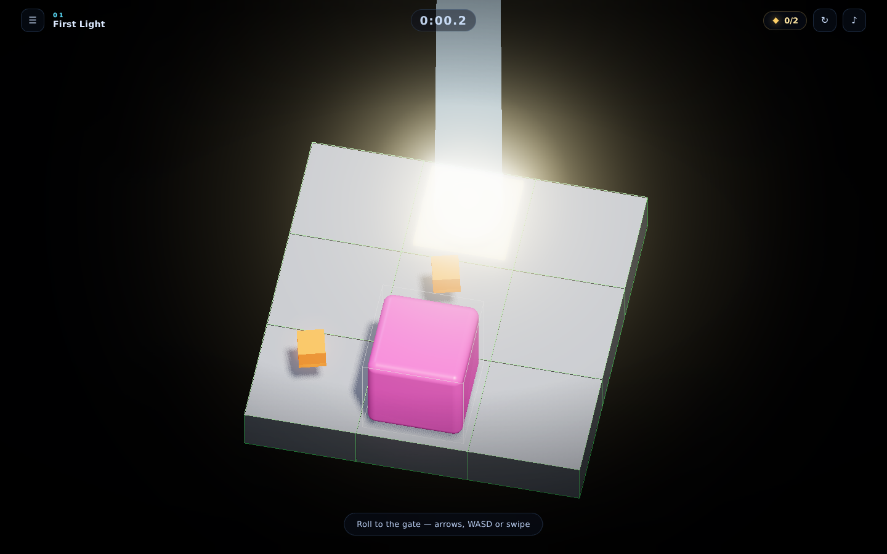
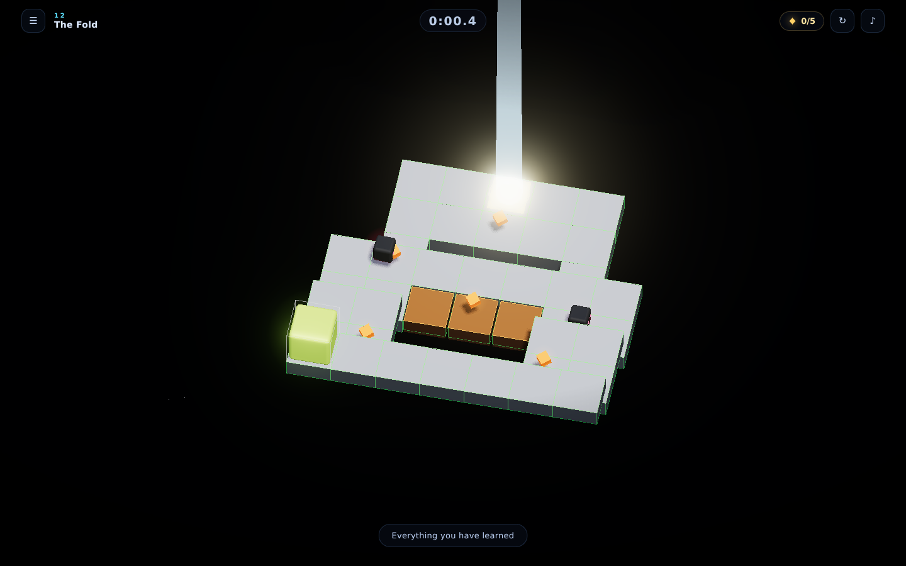
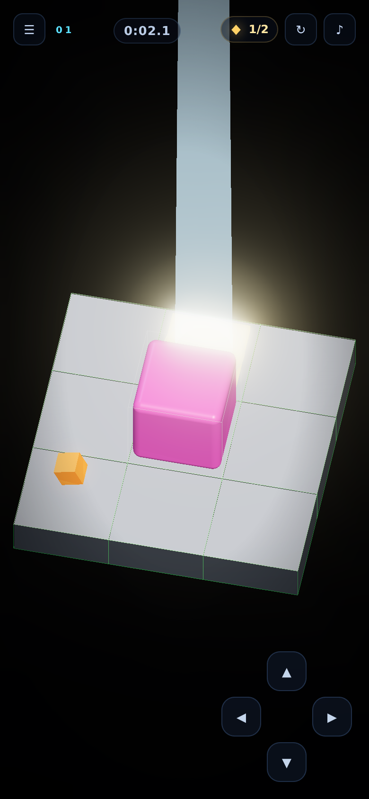

# KUBIK

A minimalist **cube-rolling puzzle game** that runs in the browser. Roll a glowing cube
across floating geometric platforms, collect shards, dodge sentinels and cracked slabs,
and find your way down to the gate.

Built from scratch as an homage to Mobigame's classic **EDGE** — original code, art,
level design and a fully procedural soundtrack. No assets are borrowed from the original
game; the name, visuals and levels here are our own.



 

---

## Play

```bash
npm install
npm run dev      # → http://localhost:5173
```

Other commands:

| command | what it does |
| --- | --- |
| `npm run build` | production build into `dist/` |
| `npm run preview` | serve the production build |
| `npm run verify` | prove every level is solvable (pure Node, no browser) |
| `npm run playtest` | scripted browser playtest of mechanics (win, death, crumble, pause…) |
| `npm run autoplay` | plays all 12 levels end to end in a headless browser |

The two browser-based scripts drive Chromium through `puppeteer-core`; point them at a
browser with `CHROME_PATH`, or install Playwright/Chrome beforehand.

## Controls

| input | action |
| --- | --- |
| **W A S D** / **arrow keys** | roll the cube |
| **swipe** anywhere on the play field | roll the cube |
| on-screen D-pad (touch devices) | roll the cube |
| **R** | restart the level |
| **M** | mute / unmute |
| **Esc** | pause · **Enter** confirms on the win screen |

## The rules

* The cube rolls one tile at a time, in four directions.
* You can **fall** onto a lower slab (up to two steps down) — you can **never climb**.
  Rolling into a wall just bumps you back.
* Rolling off the edge drops you into the void. You respawn at the start.
* **Cracked slabs** (orange) break shortly after you roll onto them.
* **Sentinels** (red orbs) patrol a route and kill on contact.
* Reach the cyan **gate** to clear the level. **Shards** are optional — grabbing all of
  them is a perfect run.

Because you can only ever go down, every level is a one-way descent: route choice is the
puzzle. The level verifier enforces two invariants so no shipped level can waste your
time — the goal is always reachable, and **no reachable tile is a dead end**
(zero soft-locks), plus a crumble-aware search proves the cracked slabs never seal the
only route.

## Levels

Twelve hand-designed levels introduce one idea at a time:

| # | level | teaches |
| --- | --- | --- |
| 01 | First Light | rolling, shards, the gate |
| 02 | Step Down | drops are allowed, climbing is not |
| 03 | Switchback | terraces and route choice |
| 04 | Twin Bridges | two paths, one run |
| 05 | Paper Bridge | cracked slabs |
| 06 | Sentinel | moving hazards |
| 07 | Weave | overlapping hazard timing |
| 08 | Cascade | long multi-level descents |
| 09 | Fault Line | cracked ground + a patrolling blade |
| 10 | Spiral | a courtyard that must be circled |
| 11 | Gauntlet | everything, at speed |
| 12 | The Fold | the full mix |

Progress unlocks level by level. Best times and shard counts are stored in
`localStorage`; there is no server and no tracking.

## Level format

Levels live in [`src/levels.js`](src/levels.js) as ASCII. Each row is a Z slice,
each character is a column, and the digit is the slab's top height. `.` is the void:

```js
{
  id: 5,
  name: 'Paper Bridge',
  hint: 'Cracked slabs fall shortly after you land',
  map: [
    '..00000..',
    '..00000..',
    '..11111..',
    '..11111..',
    '..22222..',
    '..22222..',
  ],
  start: [4, 5],
  goal: [4, 0],
  shards: [[2, 2], [6, 2], [4, 3]],
  crumble: [[3, 3], [4, 3], [5, 3]],
  orbs: [{ path: [[2, 3], [6, 3]], speed: 1.7 }],
}
```

Add a level to the array, run `npm run verify`, and it is playable — the level list,
unlock logic and camera framing all derive from the data.

## How it is built

```
src/
  main.js       UI glue: HUD, menus, input, save data, screen flow
  game.js       game loop: rolling animation, hazards, win/death states
  rules.js      pure level rules + solvability analysis (no DOM, no rendering)
  levels.js     the twelve levels as ASCII maps
  levelView.js  3D scene graph for a level: slabs, rims, shards, gate, orbs
  stage.js      renderer, orthographic 3/4 camera, shadows, lights, starfield
  audio.js      synthesised soundtrack + SFX (Web Audio, zero sample files)
  save.js       localStorage progress, best times, formatting
  textures.js   generated glow/beam textures
scripts/
  verify-levels.mjs   solvability + soft-lock proof for every level
  playtest.mjs        scripted browser checks of the mechanics
  autoplay.mjs        full 12-level completion run in a browser
```

Notable details:

* **Everything is generated.** Slab meshes are merged into a single draw call, glow
  sprites and beam textures are painted onto canvases at runtime, and the music —
  pads, bass, arpeggio, percussion — is scheduled with oscillators and noise on a
  100 BPM grid that shifts key per level. There is not one image or audio file in the
  repo.
* **Real-world lighting.** A soft sun high above the level casts true PCF soft
  shadows onto the matte porcelain slabs; a cool fill keeps shaded faces from going
  dead, and the void is a slow-drifting starfield. Each level gets its own vivid
  cube colour and accent edge colour, and the goal is a glowing pad with a beam of
  light rising out of the frame.
* **True 3D rolling.** Each move rotates the cube a quarter turn around the edge it
  tips over, easing in and out, with the exact height change applied on landing.
* **Camera.** An orthographic camera at a 3/4 angle, fitted to each level's bounds, with
  a gentle focus drift toward the cube and a shake on impacts.
* **Post-processing.** Unreal bloom plus ACES tone mapping on top of the lit scene.
  If the device can't hold ~42 fps in the first few seconds, the renderer sheds
  quality in stages — shadows first, then bloom and resolution.
* **Readable performance.** A single merged mesh per level (which still casts and
  receives shadows), capped pixel ratio, and a delta clamp so slow frames never
  teleport the cube.

## Licence

MIT for the code in this repository. Not affiliated with Mobigame; if you enjoy this,
please buy [EDGE](https://play.google.com/store/apps/details?id=net.mobigame.edge.demo)
and EDGE Extended — they are the real thing.
