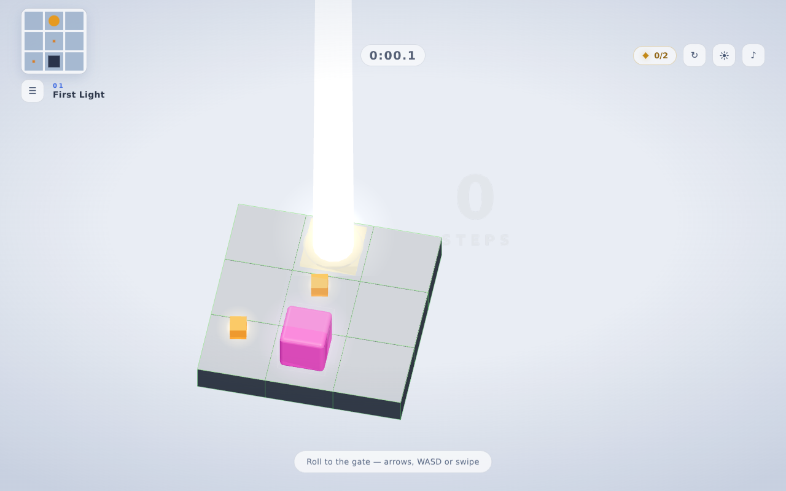
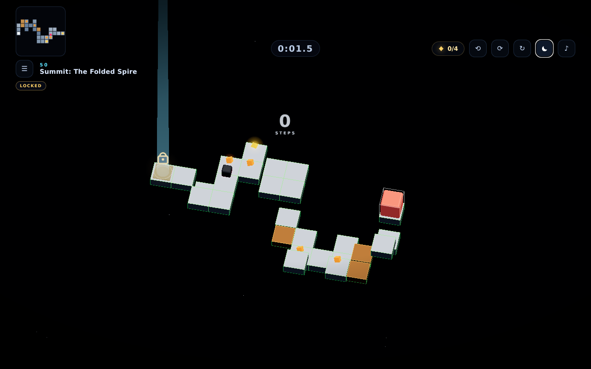
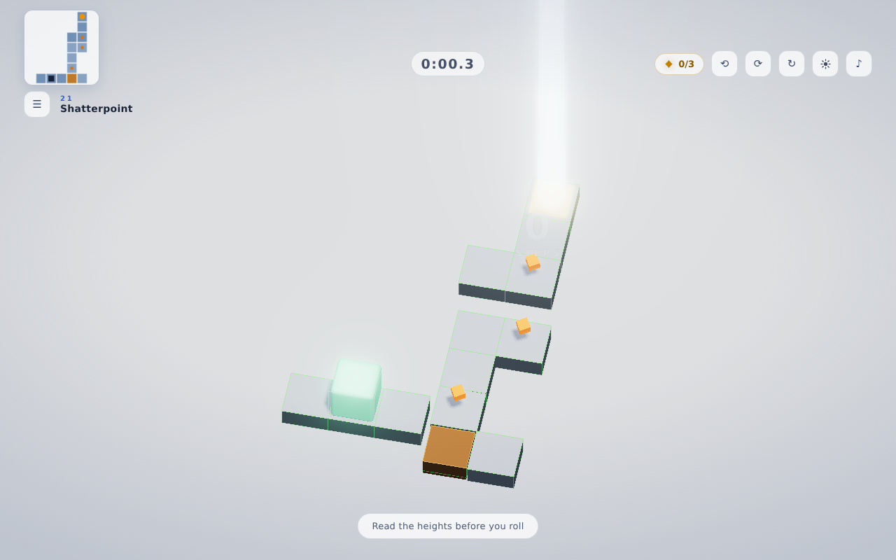
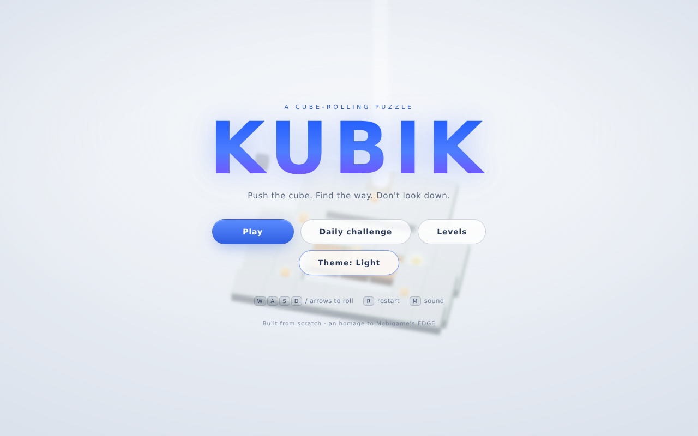

# KUBIK

A minimalist **cube-rolling puzzle game** that runs in the browser. Roll a glowing cube
across floating geometric platforms, collect shards, dodge sentinels and cracked slabs,
push dark cubes out of your way, time the sliding bridges, ride the wind and find your
way down to the gate — **50 levels** long, from a three-tile warm-up to the sealed
Summit.

Built from scratch as an homage to Mobigame's classic **EDGE** — original code, art,
level design and a fully procedural soundtrack. No assets are borrowed from the original
game; the name, visuals and levels here are our own.

Every level is proven solvable by an automated verifier, each clear earns a
bronze/silver/gold **medal**, your best run replays as a translucent **ghost**, and a
fresh **Daily Challenge** is generated (and solver-checked) for every date.

The world comes in **two themes**: a dark starfield void and a high-key "paper" sky —
one sun, two moods, switchable from the menu or the in-game HUD and remembered
between sessions.



  

---

## Play

```bash
npm install
npm run dev      # → http://localhost:5173
```

Other commands:

| command | what it does |
| --- | --- |
| `npm run build` | production build into `dist/` |
| `npm run preview` | serve the production build |
| `npm run verify` | prove all 50 levels + 14 daily layouts are solvable (pure Node, no browser) |
| `npm run playtest` | scripted browser playtest of the mechanics (64 checks: win, death, push, wind, key, bridge, ghost, medal, daily, theme, hold-to-roll, camera seats…) |
| `npm run autoplay` | plays all 50 levels end to end in a headless browser |

The two browser-based scripts drive Chromium through `puppeteer-core`; point them at a
browser with `CHROME_PATH`, or install Playwright/Chrome beforehand.

## Controls

| input | action |
| --- | --- |
| **W A S D** / **arrow keys** | roll the cube — **hold the key to keep rolling** |
| **swipe** anywhere on the play field | roll the cube — **hold the swipe to keep rolling**, drag to steer |
| on-screen D-pad (touch devices) | roll the cube — press & hold to keep rolling |
| **Q** / **E** or the **⟲ ⟳** HUD buttons | orbit the camera 90° (four seats; controls stay screen-relative) |
| **R** | restart the level |
| **M** | mute / unmute |
| **Esc** | pause · **Enter** confirms on the win screen |

## The rules

* The cube rolls one tile at a time, in all four directions.
* You can **fall** onto a lower slab (up to two steps down) or **climb** up a small step
  (one up). You just can't leap a two-tile wall — that bumps you back.
* Rolling off the edge drops you into the void. You respawn at the start.
* **Cracked slabs** (orange) break shortly after you roll onto them.
* **Sentinels** (dark cubes with glowing eyes) patrol a route and kill on contact.
* **Dark cubes** are obstacles you can *push* one tile with telekinesis — levels grant a
  limited number of pushes, and a cube only slides onto plain ground.
* **Sliding bridges** rise and sink on a clock; cross while they're up, or the bridge
  lets go of your feet.
* **Sealed gates** stay locked until you touch the level's golden **key**.
* On **wind** levels a steady breeze carries the idle cube a tile — watch the streaks.
* Reach the glowing **gate** to clear the level. **Shards** are optional — grabbing all
  of them is a perfect run.
* Every roll is counted. Clearing in the fewest possible rolls (**par**) earns a
  *par clear*; the floating number and the top-left minimap keep you oriented.
* Every clear earns a **medal**: gold for par + all shards + a fast time, silver for any
  two of the three, bronze for one. Your fastest run is recorded and replays as a
  translucent **ghost** you race against.

Because climbing is capped at one step while falling is capped at two, most levels still
read as a descent — but you can backtrack and explore. The level verifier enforces
invariants so no shipped level can waste your time — the goal is always reachable,
**no reachable tile is a dead end** (zero soft-locks), a crumble-aware search proves the
cracked slabs never seal the only route, no sentinel may spawn on top of the player or
the goal, and levels with pushes are proven solvable with the pushes they grant.

## Two themes, one world

Like EDGE, KUBIK has two moods for the same platforms:

* **Dark** — a starfield void, warm key light, deep blue fill, star particles and a
  touch of bloom. The classic night run.
* **Light** — a high-key near-white sky, brighter sun, no stars, softer shadows. The
  porcelain "paper" run.

The switch only re-tunes the lighting rig (background, hemisphere/key/fill lights,
exposure, bloom, stars) — the slabs, hazards and rules are identical, so a run feels
the same in either world. The UI re-skins to match: ink-on-paper panels, a light
minimap, deeper-blue accents.

Toggle it with the **moon/sun button** in the HUD (top right) or the **Theme** button
on the title menu. The choice is saved in your progress and restored on the next
visit.

## Levels

Fifty levels. The first thirteen are hand-designed, each teaching one idea:

| # | level | teaches |
| --- | --- | --- |
| 01 | First Light | rolling, shards, the gate |
| 02 | Step Down | you can fall 2 but only climb 1 |
| 03 | Switchback | terraces and route choice |
| 04 | Twin Bridges | telekinesis — push a dark cube to open a bridgehead |
| 05 | Paper Bridge | cracked slabs |
| 06 | Sentinel | moving hazards |
| 07 | Weave | hazard timing + an optional shove shortcut |
| 08 | Cascade | the wind carries an idle cube |
| 09 | Fault Line | cracked ground + a patrolling blade |
| 10 | Spiral | a courtyard that must be circled |
| 11 | Gauntlet | everything, at speed |
| 12 | The Fold | a sealed gate and its key |
| 13 | Boss: The Folded Keep | sentinels + crumble + sliding bridges, all at once |

Levels **14–50** are a generated campaign — the same "random, then prove it" pipeline
the daily uses, scaled up (see [How it is built](#how-it-is-built)). Difficulty ramps in
five acts:

| # | act | what changes |
| --- | --- | --- |
| 14–19 | The Descent | small maps, gentle heights, first crumble slabs |
| 20–27 | Glass Meadow | bigger maps, full height range, sentinels join |
| 28–35 | The Lattice | double hazards, more shards, longer routes |
| 36–43 | The Crucible | two sentinels, dense crumble fields |
| 44–50 | The Spire | the largest maps, **level 50 adds the sealed gate + key** |

Every generated level is rejected until the full verifier proves it — same guarantees as
the hand-made ones: solvable, zero soft-locks, no spawn-kills.

Plus a **Daily Challenge**: a fresh layout generated from the date (seeded, then run
through the same solvability verifier — always solvable, never a spawn-kill), the same
for everyone, with its own best time and medal.

Progress unlocks level by level. Best times, shard counts, medals and ghost runs are
stored in `localStorage`; there is no server and no tracking.

## Level format

Levels live in [`src/levels.js`](src/levels.js) as ASCII. Each row is a Z slice,
each character is a column, and the digit is the slab's top height. `.` is the void:

```js
{
  id: 4,
  name: 'Twin Bridges',
  hint: 'Two dark cubes guard the bridgeheads — push one aside, then cross',
  map: [
    '..00000..',
    '..00000..',
    '..11111..',
    '..11.11..',
    '..22222..',
    '...222...',
  ],
  start: [4, 5],
  goal: [4, 0],
  shards: [[2, 2], [6, 2], [4, 1]],
  blocks: [[3, 4], [5, 4]],  // dark cubes you can shove
  nudge: 2,                  // telekinesis charges
  // crumble: [[x, z]],      // cracked slabs
  // orbs: [{ path, speed }],// sentinels
  // sliders: [{ tiles, period, phase }], // rising/sinking bridge groups
  // key: [x, z],            // unlocks the sealed gate
  // wind: { x: -1, z: -1 }, // diagonal breeze
}
```

Add a level to the array, run `npm run verify`, and it is playable — the level list,
unlock logic, camera framing and HUD chips all derive from the data. The verifier
rejects malformed data (shards/orbs/keys off-slab), spawn-overlap hazards (a sentinel
on the start tile is the exact bug that used to ship in Fault Line) and unsolvable
push/crumble layouts.

## How it is built

```
src/
  main.js       UI glue: HUD + minimap + mechanic chips, menus, input, save, flow
  game.js       game loop: rolling, pushes, wind drift, bridges, gate, ghost, states
  rules.js      pure level rules + solvability analysis (no DOM, no rendering)
  levels.js     levels 1–13 as ASCII maps (+ the campaign, concatenated)
  campaign.js   levels 14–50 as static, proven level data (generated, see scripts)
  daily.js      seeded daily-level generator (date → solvable layout)
  levelView.js  3D scene graph: slabs, blocks, bridges, key/lock, wind, sentinels
  stage.js      renderer, 4-seat orbiting camera, shadows, lights, starfield, themes
  audio.js      synthesised soundtrack + SFX (Web Audio, zero sample files)
  save.js       localStorage: bests, medals, ghost runs, dailies, theme, camera seat
  textures.js   generated glow/beam textures
  style.css     UI skin — dark default + `body.light` high-key override
scripts/
  verify-levels.mjs   solvability + soft-lock + spawn-safety proof (50 levels + 14 dailies)
  gen-campaign.mjs    seeded generator that PROVES levels 14–50 (rejects until solvable)
  playtest.mjs        64 scripted browser checks: mechanics + themes + camera seats
  autoplay.mjs        full 50-level completion run in a browser
  shoot.mjs / mobile-shots.mjs   screenshot helpers
```

Notable details:

* **Everything is generated.** Slab meshes are merged into a single draw call, glow
  sprites and beam textures are painted onto canvases at runtime, and the music —
  pads, bass, arpeggio, percussion — is scheduled with oscillators and noise on a
  100 BPM grid that shifts key per level. There is not one image or audio file in the
  repo.
* **Real-world lighting.** A soft sun high above the level casts true PCF soft
  shadows onto the matte porcelain slabs; a cool fill keeps shaded faces from going
  dead, and the void is a slow-drifting starfield. Each level gets its own vivid
  cube colour and accent edge colour, and the goal is a glowing pad with a beam of
  light rising out of the frame.
* **Two themes, one world.** `Stage.setTheme('dark'|'light')` swaps the whole
  lighting rig — background, hemisphere/key/fill lights, tone-mapping exposure,
  bloom and the starfield — while the geometry, materials and rules stay identical,
  so the game plays the same in either mood. `body.light` re-skins the UI to an
  ink-on-paper high-key look (light panels, brighter minimap, deeper-blue accents)
  and the choice is persisted in the save and restored on load.
* **True 3D rolling.** Each move rotates the cube a quarter turn around the edge it
  tips over, easing in and out, with the exact height change applied on landing.
* **Score + par.** Every roll is counted by a floating 3D step counter (drawn to a
  canvas texture, so still no font asset). Each level's shortest route is computed by
  BFS as its *par*; matching it earns a *par clear*, and best steps are saved alongside
  best time. A live minimap in the HUD corner shows the layout, sentinels, shards,
  bridges, blocks and the key.
* **Medals, ghosts and dailies.** A clear is scored on par, shards and speed —
  3/3 gold, 2 silver, 1 bronze — and the best run's route is stored as a translucent
  ghost cube that replays in lockstep on every retry. The Daily Challenge is a
  seeded generator (hash of the date → mulberry32) whose candidate layouts are
  rejected until one passes the full verifier, so every day's level is guaranteed
  solvable and deterministic across devices.
* **Physics-lite mechanics.** Telekinesis shoves a dark cube one tile (the cube stays
  put, the block slides, a charge is spent — the solver tracks block positions and
  remaining pushes). Sliding bridges share the render clock, so what you see is
  exactly what kills you; the same clock drives their amber warning flash. Wind
  nudges the idle cube along a diagonal only when the landing tile is same-height or
  a small drop — it carries, it never lifts or flings. The sealed gate simply refuses
  the final roll (the cube rolls itself back) until the key is collected.
* **Camera with four seats.** An orthographic camera at a 3/4 angle, fitted to each
  level's bounds, with a gentle focus drift toward the cube and a shake on impacts.
  Q/E (or the HUD arrows) orbit it to the other three 90° seats with an eased glide;
  inputs stay screen-relative — "up" always rolls up the screen — and the minimap
  rotates to match. The chosen seat is saved.
* **Hold to keep rolling.** Keep a key, a swipe, or a pad button down and the cube
  keeps rolling that direction — a 10-tile corridor takes one input, not ten. Steering
  works mid-hold (drag towards a new edge to turn the next roll), and the hold stops
  itself on a blocked roll, a death, or the gate.
* **A campaign that proves itself.** Levels 14–50 come from `gen-campaign.mjs`: a
  seeded random walk per level id, hazards placed on the route, and every candidate
  pushed through the full verifier (reachability, soft-lock proof, crumble-aware
  solver, spawn safety, par range) — reject and regenerate until it's proven. The
  output is written as static data, so the shipped game is deterministic and every
  level stays version-controlled like the hand-made ones.
* **Post-processing.** Unreal bloom plus ACES tone mapping on top of the lit scene.
  If the device can't hold ~42 fps in the first few seconds, the renderer sheds
  quality in stages — shadows first, then bloom and resolution.
* **Readable performance.** A single merged mesh per level (which still casts and
  receives shadows), capped pixel ratio, and a delta clamp so slow frames never
  teleport the cube.

## Licence

MIT for the code in this repository. Not affiliated with Mobigame; if you enjoy this,
please buy [EDGE](https://play.google.com/store/apps/details?id=net.mobigame.edge.demo)
and EDGE Extended — they are the real thing.
