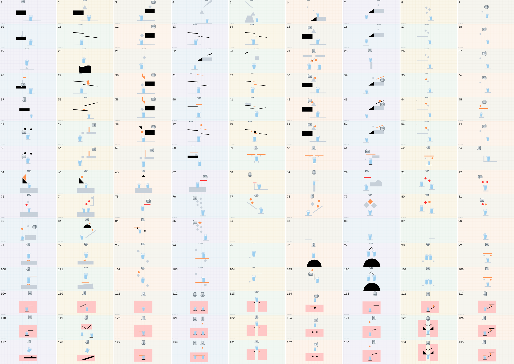

# The reference sheet, room by room

135 of the game's levels are not designed here. They are **copied** from a single document,
`glass and water levels seperated.pdf`: fifteen pages of nine rooms each, 135 cells, drawn as coloured
shapes on a white page with a thin black rule between cells.

The rule for the copy is simple and strict: **the sheet is the specification.** A room contains what
its cell contains, at the size and angle the cell draws it, in the colour the cell paints it. Nothing
is moved to make a room easier, nothing is stretched to fit, and nothing is added. The only thing the
copy does not take from the sheet is *water*: the taps are the game's taps and water comes out of
them, as it does in every other room.

---

## What the colours mean

The sheet's palette is small, and each colour is a verb:

| On the sheet | In the game | Meaning |
| --- | --- | --- |
| grey `#C7D0D9` | scenery | a solid. Ledges, blocks, shelves, wedges, balls, gears. |
| black `#000000` | scenery | a solid as well, drawn in ink black so it reads as a wall. |
| orange `#FF904D` | a **falling** piece | a loose object: it drops under gravity and can be knocked about. |
| red `#FF3131` | a **hot** surface | water that touches it evaporates. |
| pink `#FFC2C2` | a **no-draw** sheet | the player may not draw inside it. |
| the pale arrow glyph | a **tap** | water pours from the arrow's tail, in the arrow's direction. |
| the pale-blue cup | a **glass** | the thing that has to be filled. |

Cups are placed pictures in the PDF rather than drawn paths, so they are read from the document's
image list. Everything else is traced from the page's own ink.

---

## How the copy is measured

* The sheet is a portrait page, 595.5 × 842.25 pt. Its cells are 196–201 pt wide and 192–195 pt tall;
  they are not perfectly regular (a column edge moves a little between pages), so **each cell is
  fitted on its own**.
* **One cell is one screen.** A cell is scaled uniformly until it fits the area a room may use, and
  centred. Aspect ratio is never changed: nothing on the sheet is stretched, and the relative
  positions of two shapes in a cell are exactly the sheet's.
* The area a room may use starts at **y = 170**, because the game's own wooden bar and progress strip
  hang over the top of the screen, and the authored rooms keep every tap below that line too. The
  band runs to the bottom of the 1280 × 720 screen, so the scale is
  `min(1280 / cellWidth, 550 / cellHeight)`.
* Shapes are drawn at their own centre and angle, so a shelf the sheet draws tilted is tilted in the
  game by the same number of degrees.

Nothing here is a "close enough" redraw. Every solid enters the physics world through its own
outline, and the renderer draws that outline as a flat fill — no bevels, no shadows, no wood grain.

### What the copy does adapt

Two things are not on the sheet, because the sheet draws symbols rather than an engine:

* **The tap.** The sheet draws an arrow; the game draws its own tap housing with that arrow in it.
  The housing hangs from the arrow's tail, and a tail close under the top of its cell gets a shorter
  housing so it does not poke through the ink bar. The nozzle — where the water leaves — is exactly
  where the sheet's arrow starts.
* **The cup.** The sheet draws its cup in every room at whatever size its cell has room for — from
  48 px wide to 84 px wide across the 135 cells. The game has **one glass**, the 108 x 118 px glass
  every authored room uses, and a copied room gets that same glass: the sheet says *where* the cup
  stands, not how big it is. A level places a cup; it does not size one. So the cup's **foot** is put
  where the sheet draws it, and the game's glass grows up from there. It does not add a face or a
  dashed goal line, and it does not stand the glass on a hidden wooden coaster: if the sheet leaves a
  cup with nothing under it, the cup falls, exactly as a loose object should.

Everything else — every grey, black, orange, red and pink shape — is the sheet's own geometry, at its
own size, in its own place.

---

## How it was extracted, and how it is checked

The pipeline lives outside the repository (it needs PyMuPDF and OpenCV to read the PDF). It works in
three steps:

1. **Find the grid.** The page's rules are vector strokes, so the three column edges and three row
   edges are read straight from them. Each cell is the rectangle between them.
2. **Trace the ink.** The page is rendered at 5× and each colour family is isolated as a mask. Every
   blob is classified:
   * a **bar** only when it really is a rectangle — the test is overlap against its own tightest
     box, not a fill ratio, because a slab with a wavy top edge still fills 89 % of its box and used
     to be flattened into a plain bar;
   * a **disc** when it is round — rings are filled before the fit, and a small solid dot at the
     centre of a bigger glyph is treated as that glyph's hub;
   * otherwise its **outline**, simplified to the fewest vertices that still explain the ink (a
     diamond stays four points; a dome keeps as many as its curve needs).
3. **Recognise the taps.** A tap is an arrow, and the arrow is recognised from the polygon itself: a
   single tip vertex, a tail edge about half the glyph's width, centred on the tip, and a silhouette
   that matches the sheet's arrow. That test works on every arrow size on the sheet — from a 12.8 pt
   arrow to a 35 pt one — and it does not fire on round shapes. A shaft drawn as its own thin blob is
   recognised as part of the glyph, not as a wall the player has to deal with.

Two checks run over the result:

* **Is every shape drawn in its own colour, where the sheet puts it?** Each shape's outline is painted
  into a mask in the room's frame and compared with the rendered room's mask of the same colour.
  **456 of 487** shapes match at ≥ 72 % coverage. The remainder are hairlines two to four pixels
  thick, where a one-pixel offset costs most of the mask. Arrow glyphs are excluded, because the tap
  housing draws those.
* **Does every room render and play?** All 175 levels (40 authored + 135 copied) build and draw a
  frame in the single-file build (`npm run smoke`), with no exceptions. `npm run verify` and
  `npm run verify-sheet` replay a recorded stroke in every room and report each room they cannot win.

### Where the rooms stand after the one-glass change

Moving every copied cup to the game's glass, and halving the water droplet, changed the geometry of
every copied room: a stroke drawn to land in a 79 px cup does not land in a 108 px one. The recorded
strokes are being re-proved room by room (`tools/repair-sheet.js`), and the honest count today is
**29 of 135** copied rooms won with their recorded stroke (the rest are reported with the fill they
actually reach, not given an easier goal). The authored rooms are **33 of 40**: the seven that no
longer replay are rooms whose recorded stroke was drawn for the old droplet (`npm run verify` lists
them).

Neither number is papered over. A room is only counted as playable when a stroke is replayed and
wins.

---

## What the cells contain

| | Count |
| --- | --- |
| cells | 135 |
| shapes traced | 617 (grey 340, black 133, orange 99, pink 32, red 13) |
| taps | 130 (three rooms have two) |
| cups | 145 (thirteen rooms have two; two cups are drawn tilted, room 127 and 128) |
| solids | 341 |
| falling pieces | 99 (70 rooms) |
| hot surfaces | 13 (10 rooms) |
| no-draw sheets | 32 (27 rooms) |

Every copied room carries a flat ink budget of 900 px, because the sheet does not say how much ink a
room is worth — it only draws the room. Nothing new moves on its own: orange pieces fall, hot
surfaces evaporate, pink sheets refuse ink. Those are the whole of the added dynamics, and they are
the sheet's own three colours.

---

## Rooms the sheet cannot water

The copy does not add anything, so a cell without a tap stays a cell without a tap. Eight of them have
no arrow at all:

| Room | What the cell contains |
| --- | --- |
| 8 | a cup, three loose diamonds and no tap |
| 10 | a cup and scenery, no tap |
| 74 | two cups, a hot bar and two hot balls, no tap |
| 86 | **nothing at all** — the cell is empty |
| 87, 89 | a bar and no cup |
| 88, 90 | a cup and a shelf, no tap |

They load, draw and run, but they cannot be won: there is no water to fill a cup with, and in three of
them nothing to fill. They are reported here rather than quietly given a tap, because a tap would be a
change to the sheet. Winning the room *before* a tap-less one unlocks past it, so a cell with no arrow
can never wall off the rest of the set.

## Where the copy stands

The copied rooms are proved by playing them: `tools/solve-sheet.js` searches for a stroke that fills
every cup, anchored only to what the sheet itself provides (the tap housing and the room's own
shapes) — a copied line cannot float, because an unsupported line falls out of the level. A stroke is
accepted only if it wins in the exact form it is written down, then replayed.

| | Rooms |
| --- | --- |
| no ink needed — the tap's own stream fills the cup | 52 |
| one stroke, proved and replayed | 58 |
| **proved by playing** | **110 / 135** |
| no tap on the sheet, so nothing to prove | 8 |
| with a tap, not yet solved | 17 |

The seventeen are rooms where the sheet's own furniture stands in the way of its own tap: a shelf
directly under the nozzle, a cup tucked behind a wall, two cups that one stream cannot reach. The
search climbs toward the goal — it keeps the best losing stroke and nudges it — but it has not found
the line for them. They are printed by `npm run verify-sheet` with the fill each cup actually
reached, so *we have not found the stroke* stays visibly different from *this cell cannot be watered*,
instead of being hidden behind a lower goal line. Room 66 is the clearest of them: one tap, two cups
either side of a black wedge, and the best stroke the search finds gets a cup to 0.91 of its goal —
close, and still out of reach, because the water has to leave through the one gap the sheet drew.

Lowering a cup's goal to whatever an unanchored stroke happened to reach would make the copy a lie,
so it is not done. The goal of every copied cup is fixed at 0.72 of its own interior: the water line
the sheet draws just under each rim, nudged down only enough that a player is not asked for a
pixel-perfect fill.
